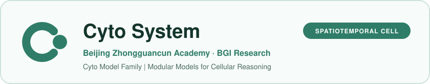

  <picture>
    <source media="(prefers-color-scheme: dark)" srcset="https://raw.githubusercontent.com/Cyto-System/.github/main/profile/assets/cyto_system_banner_dark.svg">
    <source media="(prefers-color-scheme: light)" srcset="https://raw.githubusercontent.com/Cyto-System/.github/main/profile/assets/cyto_system_banner_light.svg">
    
  </picture>

<h1 align="center">
  <picture>
    <source media="(prefers-color-scheme: dark)" srcset="https://raw.githubusercontent.com/Cyto-System/.github/main/profile/assets/cyto_logo_dark.svg">
    <source media="(prefers-color-scheme: light)" srcset="https://raw.githubusercontent.com/Cyto-System/.github/main/profile/assets/cyto_logo_light.svg">
    
  </picture>
  &nbsp;Cyto Model Family
</h1>

  <strong>English</strong> &nbsp;|&nbsp; <a href="https://github.com/Cyto-System/.github/blob/main/profile/README_zh.md">简体中文</a>

  <strong>Jointly developed by Beijing Zhongguancun Academy &amp; BGI Research</strong> 
  Building modular, verifiable, and practical computational models for spatiotemporal cell simulation and cellular response prediction.

  
  
  

---

## About the Cyto Family

**Cyto** is a family of spatiotemporal cell models jointly developed by **Beijing Zhongguancun Academy** and **BGI Research**. Cyto is not a single model, but a system of seven state-aware, intervention-capable, and evolvable submodels for spatiotemporal cells. At the system level, **Cyto.CoScientist** orchestrates the six axis-aligned models, which are organized along a **spatial axis** and a **temporal axis**.

> [!IMPORTANT]
> ### Cyto.CoScientist · System Orchestrator
>
> **Cyto.CoScientist** is the autonomous scientific layer of the Cyto system. It coordinates the six axis-aligned models, turns their outputs into testable biological hypotheses, designs cell-intervention experiments, validates the results, and iterates the discovery loop.

| Axis | Core role | Submodels and progression |
| :--- | :--- | :--- |
| **Spatial axis · Read the cell** | Resolves relationships among omics layers across spatial scales | **Cyto.Genome** (molecular level) → **Cyto.Multiomics** (single-cell multi-omics) → **Cyto.Spatial** (tissue microenvironment / niche) |
| **Temporal axis · Infer the cell** | Resolves current identity, natural evolution, and counterfactual outcomes after intervention | **Cyto.Identity** (“who it is”) → **Cyto.Dynamics** (“how it will change”) → **Cyto.Perturbation** (“what happens after intervention”) |

The intersection of the two axes captures the complete state of a spatiotemporal cell and provides the shared state representation through which **Cyto.CoScientist** drives closed-loop discovery.

A reinforcement-learning-based active identification mechanism runs throughout the system under the coordination of **Cyto.CoScientist**. This active-learning paradigm identifies where model uncertainty is highest, guides targeted data production, and prioritizes the generation of high-value AI-ready data. These data flow back to train each module, connecting computational and experimental discovery in a closed wet-lab/dry-lab loop.

Cyto is designed for applications including spatiotemporal pathology, complex disease cohorts, and drug discovery. A unified benchmarking framework supports model evaluation and advances exploration across the life sciences.

---

## Model Family & Repositories

| Module | Method | Scope | Repository & Resources |
| :--- | :--- | :--- | :--- |
| <picture><source media="(prefers-color-scheme: dark)" srcset="https://raw.githubusercontent.com/Cyto-System/.github/main/profile/assets/cyto_logo_dark.svg"><source media="(prefers-color-scheme: light)" srcset="https://raw.githubusercontent.com/Cyto-System/.github/main/profile/assets/cyto_logo_light.svg"></picture> **[Cyto.Spatial](https://github.com/Cyto-System/Cyto.Spatial)** | **SUDOKU** (Generative Spatial Foundation) | Cross-slice spatial transcriptomics niche representation, multi-scale clustering, and masked cell-state generation | [GitHub (Cyto.Spatial)](https://github.com/Cyto-System/Cyto.Spatial) |
| <picture><source media="(prefers-color-scheme: dark)" srcset="https://raw.githubusercontent.com/Cyto-System/.github/main/profile/assets/cyto_logo_dark.svg"><source media="(prefers-color-scheme: light)" srcset="https://raw.githubusercontent.com/Cyto-System/.github/main/profile/assets/cyto_logo_light.svg"></picture> **[Cyto.Identity](https://github.com/Cyto-System/Cyto.Identity)** | **scVerity** (Evidence-Grounded Reasoning) | Cell identity and state annotation across unseen cell types, sibling subtypes, and rare lineages, with query-sample molecular evidence, ontology constraints, and multimodal validation | [GitHub (Cyto.Identity)](https://github.com/Cyto-System/Cyto.Identity) |
| <picture><source media="(prefers-color-scheme: dark)" srcset="https://raw.githubusercontent.com/Cyto-System/.github/main/profile/assets/cyto_logo_dark.svg"><source media="(prefers-color-scheme: light)" srcset="https://raw.githubusercontent.com/Cyto-System/.github/main/profile/assets/cyto_logo_light.svg"></picture> **[Cyto.Perturbation](https://github.com/Cyto-System/Cyto.Perturbation)** | **RELAY** (Anchored Dense Response Contrast Transfer) | Same-cell unseen genetic & drug perturbations, plus zero-shot cross-cell perturbation transfer | [GitHub (Cyto.Perturbation)](https://github.com/Cyto-System/Cyto.Perturbation) · [Hugging Face](https://huggingface.co/KassdinZheng/Cyto.Perturbation) |
| <picture><source media="(prefers-color-scheme: dark)" srcset="https://raw.githubusercontent.com/Cyto-System/.github/main/profile/assets/cyto_logo_dark.svg"><source media="(prefers-color-scheme: light)" srcset="https://raw.githubusercontent.com/Cyto-System/.github/main/profile/assets/cyto_logo_light.svg"></picture> **[Cyto.CoScientist](https://github.com/Cyto-System/Cyto.CoScientist)** | **Within-Task RSI** (Evidence-Gated Autonomous Research) | Autonomous hypothesis refinement, multi-branch candidate evolution, and auditable multi-omics workflows | [GitHub (Cyto.CoScientist)](https://github.com/Cyto-System/Cyto.CoScientist) |
| <picture><source media="(prefers-color-scheme: dark)" srcset="https://raw.githubusercontent.com/Cyto-System/.github/main/profile/assets/cyto_logo_dark.svg"><source media="(prefers-color-scheme: light)" srcset="https://raw.githubusercontent.com/Cyto-System/.github/main/profile/assets/cyto_logo_light.svg"></picture> **Cyto.Genome** | **Genome-to-Multi-Omics Foundation** | Cell-type-specific multi-omics track prediction and modality completion from DNA sequence to molecular expression | Open-sourcing soon |

Additional modules in the Cyto model family will be added to this index as they are open-sourced.

---

## Institutions

**Cyto System** is jointly developed by:
- **Beijing Zhongguancun Academy**
- **BGI Research**
